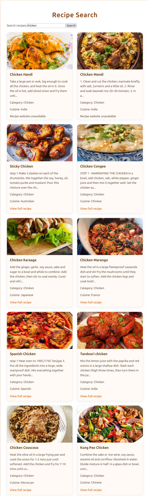
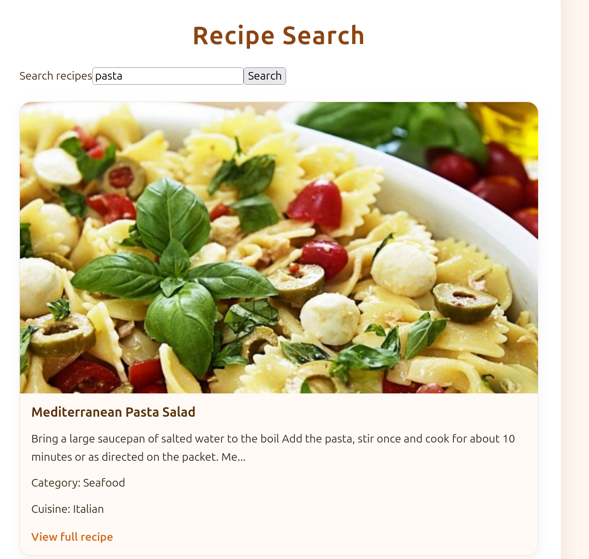
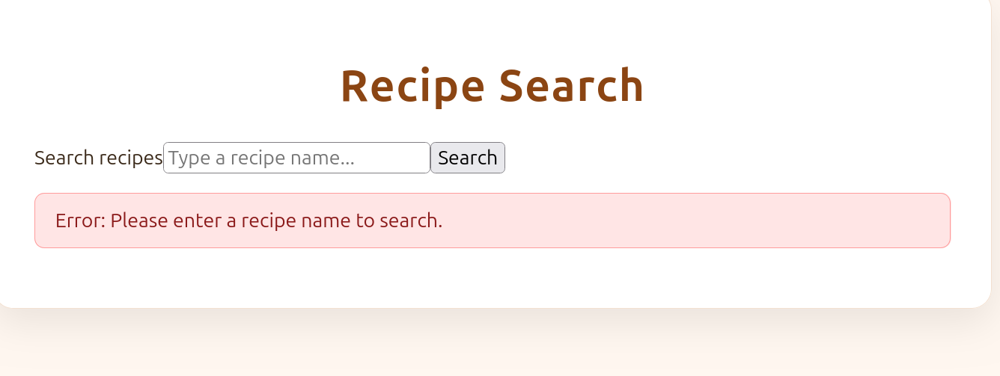

# Recipe Search

A Preact-based recipe search application that allows users to search for recipes and view recipe information through a clean, responsive interface. The application uses TheMealDB API to retrieve recipe data dynamically based on user searches.

## Screenshots

### Main Application



### Pasta Search Results



### Empty Search Results



## Features

- Search for recipes by name.
- Retrieve recipe data dynamically from TheMealDB API.
- Display recipe titles, descriptions, images, categories, and cuisine information.
- Display loading feedback while fetching recipes.
- Show a message when no recipes match a search.
- Display user-friendly error messages when a request fails.
- Validate empty search submissions.
- Open available recipe sources in a new browser tab.
- Use reusable components to organize the application.
- Responsive recipe card layout.
- Lazy-load recipe images to improve loading performance.

## Technologies Used

- **Preact** – Component-based frontend library.
- **JavaScript** – Application logic and API integration.
- **HTML5** – Application structure.
- **CSS3** – Styling and responsive layouts.
- **Vite** – Development server and production build tool.
- **Fetch API** – HTTP requests to retrieve recipe data.
- **TheMealDB API** – External recipe data source.
- **Git and GitHub** – Version control and project hosting.

## Project Structure

```text
recipe-search-preact/
├── public/
│   ├── favicon.svg
│   └── icons.svg
├── src/
│   ├── assets/
│   ├── components/
│   │   ├── RecipeItem.jsx
│   │   ├── RecipeList.jsx
│   │   └── SearchForm.jsx
│   ├── app.css
│   ├── app.jsx
│   ├── index.css
│   └── main.jsx
├── screenshots/
│   ├── recipe-search.png
│   ├── pasta-search.png
│   └── no-results.png
├── index.html
├── package.json
├── package-lock.json
└── vite.config.js
```

## Getting Started

### Prerequisites

- Node.js
- npm

### Installation

Clone the repository:

```bash
git clone git@github.com:heintzmason2-sys/recipe-search-preact.git
```

Navigate into the project directory:

```bash
cd recipe-search-preact
```

Install the project dependencies:

```bash
npm install
```

### Running the Development Server

Start the Vite development server:

```bash
npm run dev
```

Open the local address displayed in your terminal, usually:

```text
http://localhost:5173/
```

### Production Build

Create an optimized production build:

```bash
npm run build
```

Preview the production build locally:

```bash
npm run preview
```

## API Integration

The application uses TheMealDB API to search for recipes by name.

API requests are performed using JavaScript's Fetch API and async/await.

The application transforms the original API response into a simplified recipe object containing:

- Recipe ID
- Title
- Description
- Image URL
- Recipe source URL
- Category
- Cuisine

Recipe descriptions are shortened for display, and fallback values are provided when certain API fields are unavailable.

The application also checks HTTP response status codes and handles unsuccessful requests through error handling.

## Component Architecture

The application is organized into reusable components to separate responsibilities and make the code easier to maintain.

### App.jsx

The main application component.

- Manages application state using Preact hooks.
- Handles search input and form submission.
- Fetches recipe data from TheMealDB API.
- Transforms API responses into application-friendly objects
